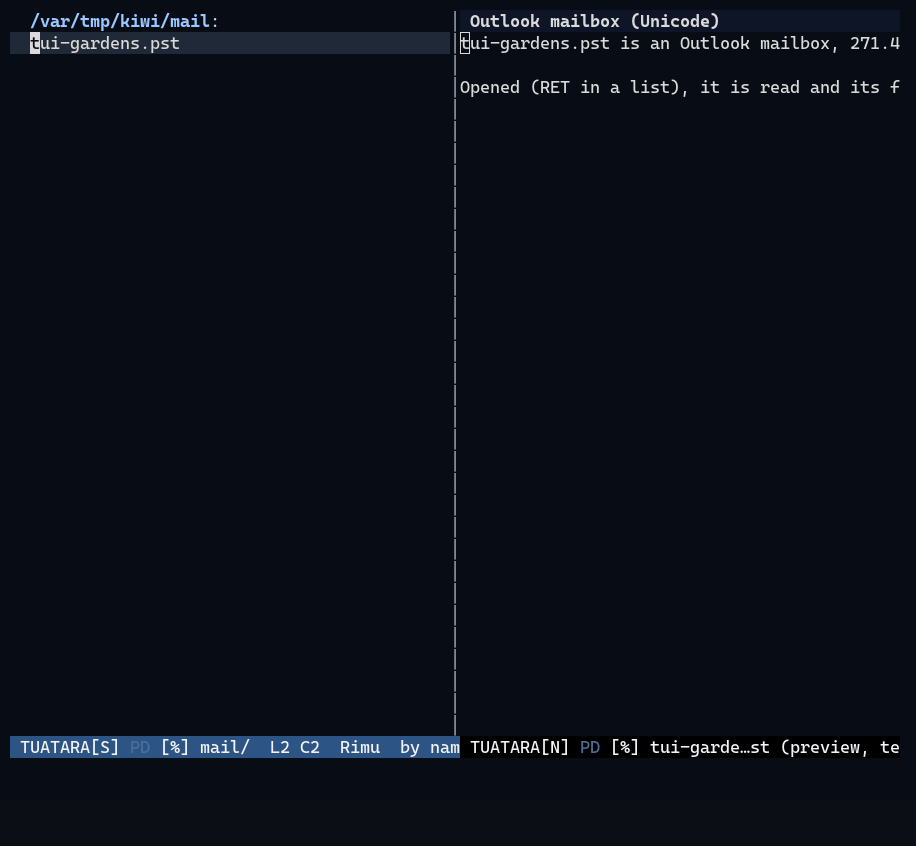

# outlook

Read the manual:
[tuatara-editor.github.io/tuatara-outlook](https://tuatara-editor.github.io/tuatara-outlook/).

Outlook items (`.msg`), saved mail (`.eml`) and Outlook mailboxes (`.pst`,
`.ost`), read as messages, read only. One of the Tuatara project's packages, not
part of the editor.

It is made for examining mail from evidence. Nothing in a message is run, an
attachment is opened only when you ask and from a private copy, and the files
read are never changed. A mailbox is read by the package itself, in a sandbox,
however large it is.

Once it is loaded, opening one of these files shows a message, or a list of the
messages of a mailbox, which can be searched, filtered, labelled and copied out.
The manual says how, with every key, command and setting.

<picture>
  <source media="(prefers-color-scheme: light)" srcset="media/outlook-light.gif">
  
</picture>

## What it needs

- Tuatara 0.90.38 or later.
- bubblewrap, to read a mailbox. Tuatara needs it for every file from outside.
- WeasyPrint, only to see a message as it looks (`P`).

| System | Command |
|---|---|
| Fedora | `sudo dnf install bubblewrap weasyprint` |
| Ubuntu, Debian | `sudo apt install bubblewrap weasyprint` |
| Arch, Omarchy | `sudo pacman -S bubblewrap python-weasyprint` |

## Installing it, step by step

1. **Install what it needs**, with the command for your system above.
2. **Open your init file**: in Tuatara press `C-x C-f`, type
   `~/.config/tuatara/init.lisp` and press `RET`.
3. **Add this line** to it:

   ```lisp
   (load-package "outlook" :source "https://github.com/Tuatara-Editor/tuatara-outlook")
   ```

4. **Save** with `C-x C-s`, **quit** with `C-x C-c`, and **start Tuatara
   again**. Answer `y` when it asks whether to load outlook; it asks once.
5. **Check it**: `M-x check-health` says whether WeasyPrint is found; then open
   a `.msg`, `.eml` or `.pst` file.

## On a machine without internet

Tuatara compiles the package itself, so only fetching it needs the internet.
On a machine with internet:

```sh
git clone https://github.com/Tuatara-Editor/tuatara-outlook
git -C tuatara-outlook verify-tag "$(git -C tuatara-outlook describe --tags --abbrev=0)"
```

Copy the directory to the other machine, for instance to
`~/tuatara-packages/tuatara-outlook`, install WeasyPrint there from the
system's own packages, and name the directory in the init file:

```lisp
(load-package "outlook" :source "~/tuatara-packages/tuatara-outlook")
```

Carrying over the compiled files as well, so the other machine skips the
compiling, is in Tuatara's manual, chapter 19, "On a machine without
internet".

## Credits

- Microsoft's Open Specifications, MS-CFB and MS-OXMSG: how an Outlook item is
  read and written; MS-PST (revision 11.2): how a mailbox is read and written.
- libpst's `readpst`, which read mailboxes before, and libpff's `pffexport`,
  against which the package's reading was checked.
- WeasyPrint: how a message is drawn as it looks.

## License

GPL-3.0-or-later; see `LICENSE` at the top of this repository.

## Working on it

```sh
tools/test.sh
```

runs its tests against a Tuatara source tree: `../tuatara` beside this
repository, or `../../tuatara` beside the directory it is in, unless
`TUATARA_SOURCE` names another. How a package is laid out and which of
Tuatara's names it may use are in Tuatara's
[HACKING.org](https://github.com/Tuatara-Editor/tuatara/blob/main/HACKING.org);
bug reports, ideas and how changes are made in
[CONTRIBUTING.md](CONTRIBUTING.md). The manual's source is in `doc/manual/`;
`tools/manual-html.sh` in a Tuatara tree, given this repository's directory,
makes its pages.
